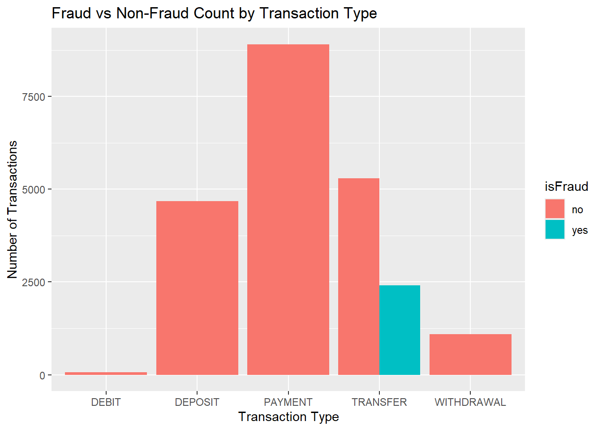
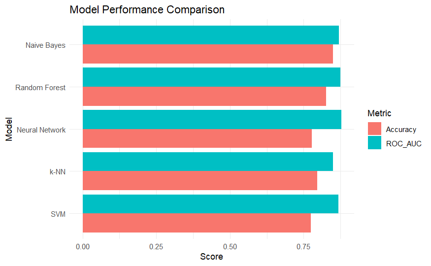
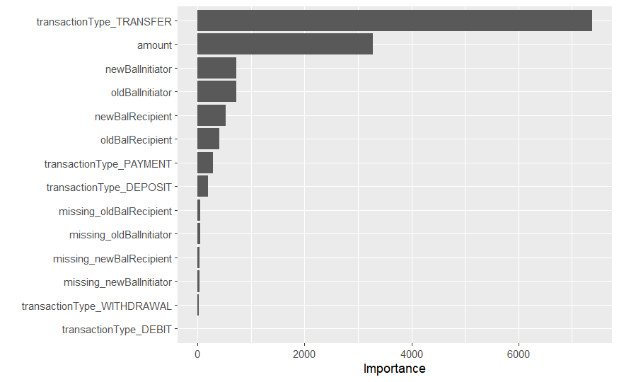

# Mobile Money Fraud Detection

End-to-end machine learning project to detect fraudulent transactions in a simulated mobile money dataset (**FinSim-Mobile**), built in **R** with the **tidymodels** ecosystem.

Developed for the *Fraud Detection* (Deteção de Fraude) course of the MSc in Information Security at the University of Porto, 2025/26.



## Overview

| | |
|---|---|
| **Problem** | Binary classification: is a mobile money transaction fraudulent? |
| **Data** | 22,440 labelled transactions (10.7% fraud) + 3,319 unlabelled test transactions |
| **Stack** | R, tidymodels (recipes, parsnip, tune, yardstick), smotefamily, ranger, kernlab, nnet, kknn, klaR, factoextra, dbscan |
| **Models** | k-NN, Naive Bayes, Random Forest, SVM (RBF), Neural Network (MLP) |
| **Evaluation** | 5-fold CV tuning on ROC AUC; held-out 20% test split; Kaggle submission |

The project follows a CRISP-DM style workflow split into two notebooks:

1. **Data understanding, preparation and descriptive modelling** – exploratory analysis, data-quality fixes, a reusable preprocessing recipe, and unsupervised clustering (K-means, DBSCAN).
2. **Predictive modelling and Kaggle submission** – class rebalancing with SMOTE, hyperparameter tuning and comparison of five classifiers, and predictions on the competition test set.

## Key findings from the EDA

- **Fraud only happens in `TRANSFER` transactions** – transaction type is a near-perfect separator.
- **Missing recipient balances are a strong fraud signal**, so explicit missingness indicators were engineered before imputation.
- Fraudulent amounts cluster in a mid-range band (roughly 10K–316K).
- Time of day, step and negative balances showed little predictive value and were left out.
- Data-quality issues handled: balance columns stored as text, 10–17% missing values in balance fields, `?` used as NA marker.

## Pipeline

```
raw CSV ──► type fixes + missingness flags ──► stratified 80/20 split
        ──► recipe: median imputation · one-hot encoding · normalisation · zero-variance filter
        ──► SMOTE (training set only)
        ──► 5-fold CV grid search (ROC AUC) ──► evaluation on held-out test set
        ──► predictions for the Kaggle test set
```

## Results

Held-out test set (20% stratified split, not rebalanced):

| Model | ROC AUC | Accuracy | Precision | Recall | F1 |
|---|---:|---:|---:|---:|---:|
| Neural Network | **0.878** | 0.777 | 0.318 | 0.944 | 0.476 |
| Random Forest | 0.875 | 0.826 | 0.334 | 0.618 | 0.433 |
| Naive Bayes | 0.870 | 0.850 | 0.333 | 0.396 | 0.362 |
| SVM (RBF) | 0.868 | 0.775 | 0.320 | **0.969** | **0.481** |
| k-NN | 0.849 | 0.796 | 0.310 | 0.728 | 0.434 |



**Takeaways**

- All models land in a narrow 0.85–0.88 ROC AUC band; the Neural Network ranks best overall.
- SVM and the Neural Network catch ~95% of fraud cases (high recall), at the cost of more false alarms – a reasonable trade-off in fraud detection, where a missed fraud is usually more expensive than a manual review.
- Random Forest offers the best balance of performance and interpretability. Its feature importance confirms the EDA: `TRANSFER` type and `amount` dominate.



## Repository structure

```
├── data/
│   ├── raw/                  # FinSim-Mobile train and test CSVs
│   └── processed/            # .rds outputs of notebook 01 (generated, git-ignored)
├── notebooks/
│   ├── 01_eda_preprocessing_clustering.Rmd
│   └── 02_modeling_kaggle_submission.Rmd
├── reports/                  # Rendered HTML versions of the notebooks
├── submissions/              # Kaggle prediction files, one per model
├── images/                   # Figures used in this README
└── docs/
    └── presentation_pt.pdf   # Final presentation slides (Portuguese)
```

## Viewing the analysis

The rendered notebooks, with all code, plots and outputs, can be viewed in the browser:

- [01 – EDA, preprocessing and clustering](https://afarturc.github.io/mobile-money-fraud-detection/reports/01_eda_preprocessing_clustering.html)
- [02 – Modelling and Kaggle submission](https://afarturc.github.io/mobile-money-fraud-detection/reports/02_modeling_kaggle_submission.nb.html)

## Reproducing

Requires R and the following packages:

```r
install.packages(c(
  "tidyverse", "tidymodels", "cluster", "factoextra", "dbscan", "corrplot",
  "kknn", "discrim", "klaR", "rpart.plot", "vip", "smotefamily",
  "kernlab", "nnet", "ranger", "rmarkdown"
))
```

Run the notebooks in order from the `notebooks/` directory (notebook 02 reads the preprocessed data saved by notebook 01):

```r
rmarkdown::render("notebooks/01_eda_preprocessing_clustering.Rmd")
rmarkdown::render("notebooks/02_modeling_kaggle_submission.Rmd")
```

## Authors

- **Artur Correia** – [@afarturc](https://github.com/afarturc)
- **Matilde Regadas**
